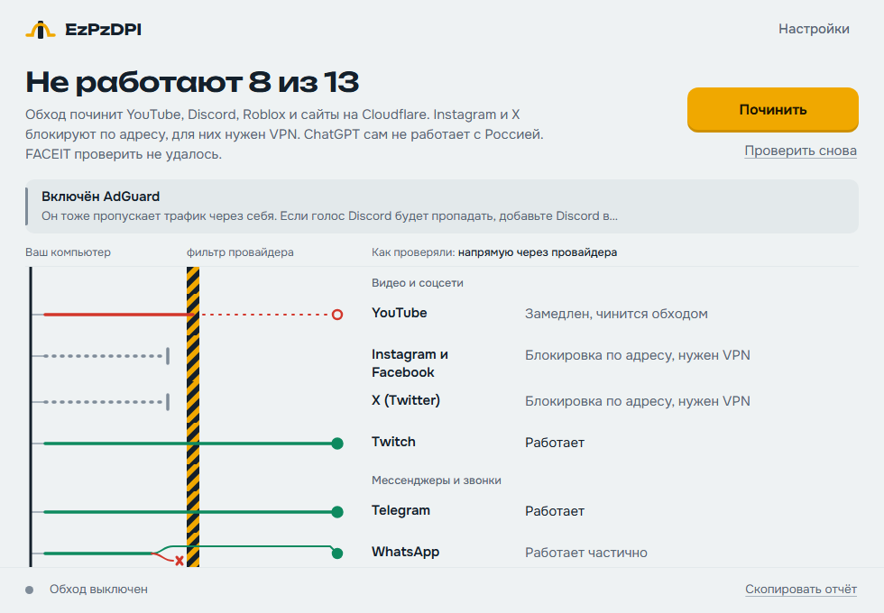
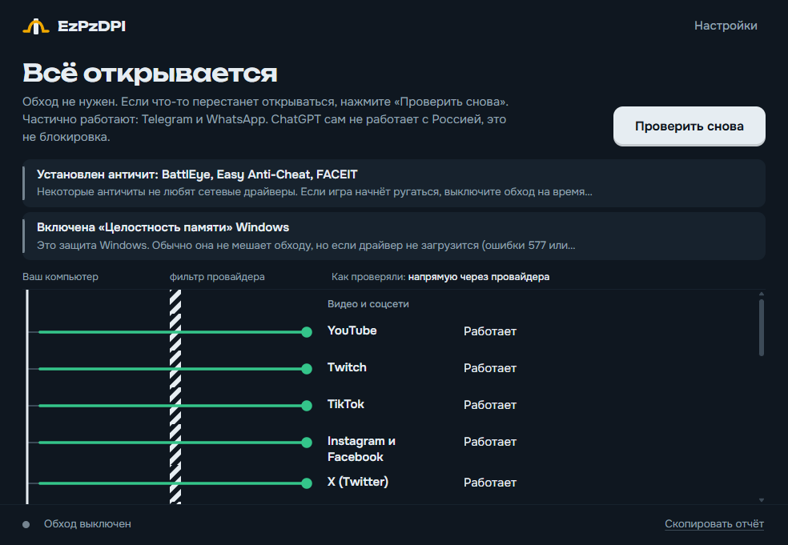

<p align="center">
  
</p>

<p align="center">
  <b>Проверка и обход блокировок на Windows в одно нажатие.</b><br>
  Открыли программу, нажали «Проверить» и увидели, что именно не работает и почему. Нажали «Починить», и EzPzDPI сам подобрал обход под вашего провайдера.
</p>

<p align="center">
  <a href="https://github.com/semanticparadox/EzPzDPI/releases/latest/download/EzPzDPI.exe"></a>
</p>

<p align="center">
  <a href="https://github.com/semanticparadox/EzPzDPI/releases/latest"></a>
  <a href="https://github.com/semanticparadox/EzPzDPI/releases"></a>
  
  <a href="LICENSE"></a>
</p>

<p align="center">
  
  <br><sub>Диагноз с блокировками: демонстрационные данные</sub>
</p>
<p align="center">
  
  <br><sub>Настоящее окно на Windows 11 в сети без блокировок</sub>
</p>

---

## Что умеет

- **Честный диагноз по каждому сервису.** YouTube, Discord, Telegram, WhatsApp, Instagram, X, Twitch, TikTok, Roblox, Steam, FACEIT, ChatGPT, звонки, сайты на Cloudflare и зарубежном хостинге. В настройках включаются ещё полтора десятка. Для каждого видно, что происходит:
  - работает;
  - заблокирован, но обход поможет;
  - замедлен (страница замирает после 16–20 КБ);
  - заблокирован по адресу, нужен VPN;
  - сервис сам не работает с Россией;
  - провайдер подменяет адрес (DNS).
- **Подбор обхода.** EzPzDPI по очереди пробует варианты zapret (набор Flowseal) и GoodbyeDPI. Каждый вариант проверяется реальным скачиванием, а не только «пинганулось». Включается лучший, и только если обычные российские сайты при нём продолжают работать.
- **Уже стоит другой обход?** EzPzDPI его найдёт (zapret от Flowseal, zapret-win-bundle, GoodbyeDPI, ByeDPI, Zapret GUI). Покажет, какой вариант в нём выбран, падает ли он и не запущено ли две программы сразу: это частая причина «то работает, то нет». Можно проверить его работу, сравнить без него или заменить. Прежний обход не удаляется и возвращается одной кнопкой.
- **Голос и звонки.** Оценка UDP так, как его использует голос: серия новых соединений и минута наблюдения. Пинг роутера показывает, рвётся ли связь ещё в Wi-Fi.
- **Защищённый DNS.** YouTube, WhatsApp и часть других сайтов в 2026 году удалены из российского DNS. Без защищённого DNS их не откроет никакой обход. В Windows 11 EzPzDPI включает его одной кнопкой и так же возвращает обратно.
- **Сам следит.** При каждом входе в Windows EzPzDPI тихо проверяет, что починенные сервисы работают. Если провайдер что-то поменял, программа подберёт новый вариант.
- **Ничего не ломает молча.** Все изменения в системе делаются только после нажатия кнопки, записываются в журнал и откатываются. Удаление возвращает всё как было: DNS, прокси, прежний обход.

## Установка

1. Скачайте [**EzPzDPI.exe**](https://github.com/semanticparadox/EzPzDPI/releases/latest/download/EzPzDPI.exe). Это один файл, установка не нужна.
2. Запустите его. Windows попросит права администратора: без них драйвер перехвата трафика WinDivert не запустится.
3. Если появится окно «Система Windows защитила ваш компьютер», нажмите «Подробнее», затем «Выполнить в любом случае». Файл не подписан платным сертификатом, поэтому SmartScreen его не знает.
4. Нажмите **«Проверить»**, а затем **«Починить»**.

После починки EzPzDPI копирует себя в `C:\ProgramData\EzPzDPI` и появляется в меню «Пуск». Скачанный файл можно удалить.

## Что важно знать

- Обход работает только для этого компьютера. Телефон, телевизор и приставка в той же сети его не получают.
- Полностью закройте браузер и Discord (в трее «Выйти») после включения обхода: старые соединения идут по-старому.
- Если включён VPN, проверка покажет VPN, а не провайдера. Перед проверкой его стоит выключить.
- На мобильном интернете во время ограничений действуют «белые списки». EzPzDPI это распознает и честно скажет, что обход там не поможет.
- Голос Discord и звонки нельзя проверить без реального звонка. Строка «Звонки и голос» показывает оценку, после включения позвоните сами.
- ChatGPT, Claude, Gemini, Spotify и Docker Hub сами не работают с Россией. Обход блокировок этого не меняет, и EzPzDPI так и пишет.

## Если что-то не так

- **Антивирус удалил файлы.** WinDivert и winws часто помечаются как HackTool или RiskWare: это драйвер перехвата сетевых пакетов, и антивирусы реагируют на сам класс программ. EzPzDPI заметит пропажу файлов и предложит добавить свою папку в исключения Защитника Windows. Для других антивирусов добавьте `C:\ProgramData\EzPzDPI` в исключения вручную.
- **Kaspersky, ESET, AdGuard и похожие** проверяют защищённые соединения и могут мешать обходу. AdGuard, по сообщениям пользователей, ломает голос Discord. EzPzDPI покажет, если найдёт их.
- **«Скопировать отчёт».** Если нужно спросить совета на форуме или в Issues, кнопка копирует диагноз простым текстом. В отчёте нет IP-адресов и аккаунтов.
- Журнал: `C:\ProgramData\EzPzDPI\logs`.

## Командная строка

```
start /wait EzPzDPI.exe -check     проверить, что открывается
start /wait EzPzDPI.exe -fix       подобрать вариант и включить обход
start /wait EzPzDPI.exe -stop      выключить обход
start /wait EzPzDPI.exe -run       включить сохранённый вариант
EzPzDPI.exe -console               текстовый режим без окна
```

EzPzDPI — оконная программа, поэтому cmd не ждёт её завершения сам: используйте `start /wait`, чтобы получить код выхода в `%ERRORLEVEL%`.

## Конфиденциальность и безопасность

- EzPzDPI бесплатна. Она никогда не просит деньги, пароли, номер телефона или вход в Госуслуги.
- Проверки подключаются к сайтам напрямую, как браузер. Авторам ничего не отправляется, телеметрии нет.
- Программа не VPN и не скрывает, кто вы. Она меняет только то, как ваш компьютер отправляет первые пакеты соединения, чтобы фильтр провайдера их не распознал.
- Рабочая папка `C:\ProgramData\EzPzDPI` доступна для записи только администраторам, потому что из неё работает системная служба.
- Сверьте SHA-256 скачанного файла с файлом `EzPzDPI.exe.sha256` в релизе.

## Статус

Версия 0.2. Сборка, разбор всех вариантов обхода (`winws --dry-run`), сетевые проверки и окно протестированы на Windows 11 без блокировок. Работа у конкретных российских провайдеров зависит от их оборудования и меняется со временем. Пожалуйста, напишите в [Issues](https://github.com/semanticparadox/EzPzDPI/issues), какой у вас провайдер, что показал диагноз и что подобралось. Кнопка «Скопировать отчёт» соберёт это за вас.

Список сервисов и правила диагноза основаны на исследовании, проверенном по первоисточникам 16 ноября 2026 года: [docs/research](docs/research).

## Сборка из исходников

Нужны Linux, macOS или WSL, Go (версия в `go.mod`), `curl`, `unzip` и `python3`:

```bash
scripts/build.sh
```

Скрипт скачивает закреплённые релизы Flowseal и GoodbyeDPI, сверяет их SHA-256, собирает архив, иконку и манифест, прогоняет тесты и кросс-компилирует `dist/EzPzDPI.exe`.

## Благодарности и лицензии

EzPzDPI только диагностирует и автоматизирует выбор. Сам обход DPI делают [zapret](https://github.com/bol-van/zapret) (bol-van), стратегии и списки поддерживает [Flowseal](https://github.com/Flowseal/zapret-discord-youtube), запасной движок — [GoodbyeDPI](https://github.com/ValdikSS/GoodbyeDPI) (ValdikSS), перехват пакетов — [WinDivert](https://github.com/basil00/WinDivert) (basil00). Окно работает на Microsoft WebView2. Шрифты — Onest и Unbounded (SIL OFL). Лицензии компонентов перечислены в [THIRD-PARTY.md](THIRD-PARTY.md). Код EzPzDPI распространяется по лицензии [MIT](LICENSE).

---

### English

EzPzDPI is a single portable Windows app for people in Russia. Press "Проверить" and it shows, per service, whether a site works, is blocked by name (fixable), throttled, blocked by IP (needs a VPN), refused by the service itself, or broken by DNS spoofing. Press "Починить" and it tests the Flowseal zapret strategy set and GoodbyeDPI against those services and installs the best one as a Windows service, rolling back if ordinary Russian sites break. It detects other bypass tools already installed (and their crashes or duplicates), estimates voice/UDP stability, can enable Windows 11 encrypted DNS, re-checks at every logon, and reverts everything on uninstall. Download `EzPzDPI.exe` from [Releases](https://github.com/semanticparadox/EzPzDPI/releases/latest).
